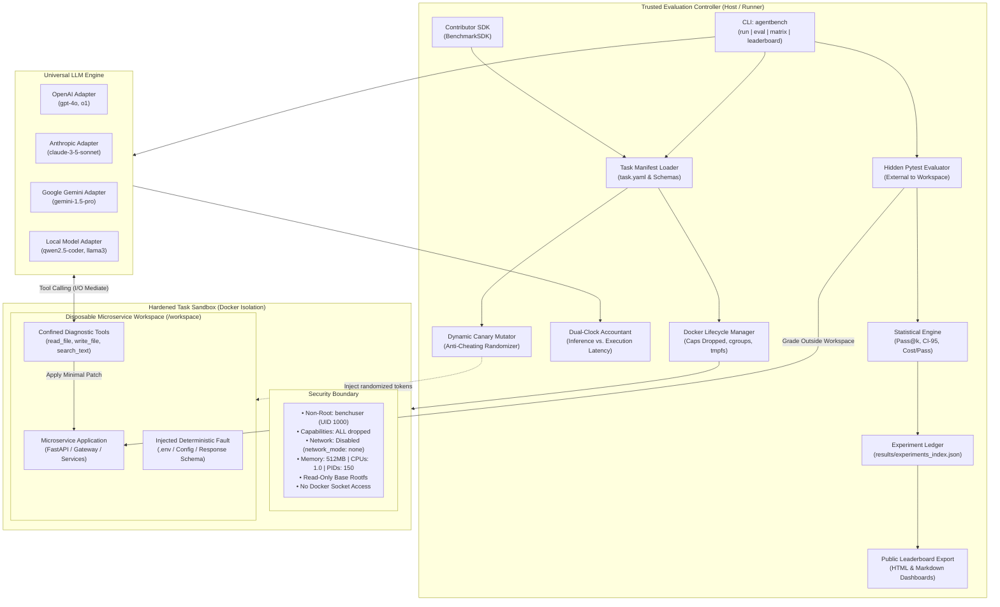
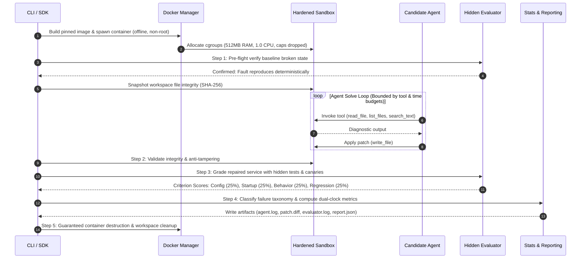
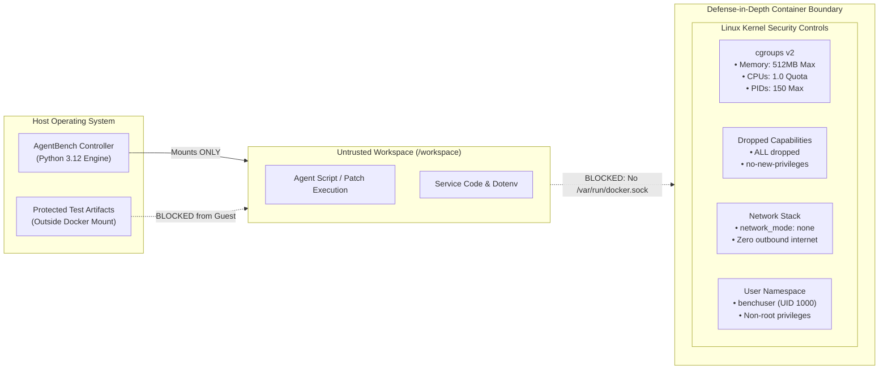
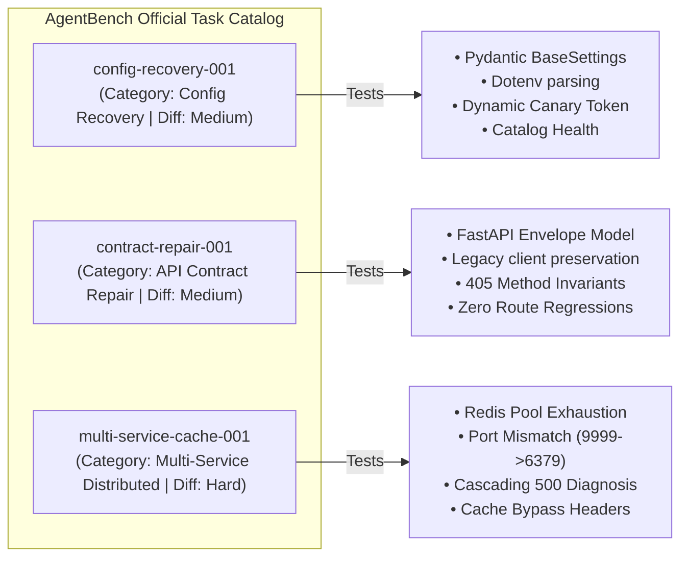

# AgentBench: AI Agent Evaluation Benchmarks

<div align="center">

[](LICENSE)
[](pyproject.toml)
[](https://github.com/genius-0963/Ai-Agent-Evaluation-Benchmarks/actions)
[](docs/security-model.md)
[](src/agentbench/stats.py)
[](https://github.com/astral-sh/ruff)

**An Industrial-Grade, Sandboxed Evaluation Framework for Autonomous AI Software Engineers.**

*Reproducible Fault Injection • Dynamic Canary Anti-Cheating • Dual-Clock Observability • Unbiased Pass@k Metrics*

---

> [!NOTE]
> ### HandshakeAI Project Dynamo Initiative
> **AgentBench** is an official fellow project engineered under the **HandshakeAI Project Dynamo** initiative, dedicated to advancing trustworthy, auditable, and production-grade evaluation infrastructure for autonomous AI systems and developer tooling.

</div>

---

## 1. Executive Summary & Problem Space

Evaluating AI coding agents on raw code generation or basic unit tests fails to reflect the complexity of real-world software engineering. Existing benchmarks suffer from four fundamental flaws:

1. **Static Test Hardcoding**: LLMs can inspect test assertions and hardcode literal return values rather than fixing underlying faults.
2. **Single-Attempt Sample Variance**: A model succeeding once does not demonstrate engineering competency. Without combinatorial $\text{Pass@}k$ and variance accounting, rankings are statistically untrustworthy.
3. **Insecure & Uncontrolled Sandboxes**: Many frameworks mount `/var/run/docker.sock` directly into agent workspaces or allow open internet access, creating severe security vulnerabilities and uncontrolled network leakage.
4. **Latency Conflation**: Wall-clock metrics conflate remote LLM inference delays (token generation, network round-trips) with local code execution latency.

**AgentBench** provides a hardened, deterministic, multi-service evaluation benchmark that enforces **defense-in-depth sandboxing**, **dynamic canary-based anti-cheating**, **dual-clock observability**, and **regression-aware patch evaluation**.

---

## 2. System Architecture

The following diagram illustrates the complete AgentBench platform architecture, showing the strict isolation boundary between the trusted controller domain and the untrusted agent workspace.



---

## 3. End-to-End Evaluation Lifecycle

Every benchmark evaluation follows an immutable 9-stage verification state machine:



---

## 4. Mathematical & Statistical Framework

AgentBench abandons naive single-run pass rates in favor of peer-reviewed statistical metrics.

### Unbiased Pass@k Estimator
Following Chen et al. (*HumanEval*), for $n$ total evaluation trials per task where $c$ trials succeed ($c \le n$), the unbiased estimator for $\text{Pass@}k$ is computed as:

$$\text{Pass@}k = \mathbb{E}\left[1 - \frac{\binom{n - c}{k}}{\binom{n}{k}}\right] = 1.0 - \prod_{i=1}^{k} \left(\frac{n - c - i + 1}{n - i + 1}\right)$$

> **Boundary Condition**: If $(n - c) \lt k$, then $\text{Pass@}k \equiv 1.0$ (at least one success is guaranteed within $k$ draws).

### 95% Confidence Interval & Score Variance
Score dispersion across repeated trials is estimated via sample variance $s^2$ and Student's $t$-distribution critical margins:

$$s^2 = \frac{1}{n - 1} \sum_{i=1}^{n} (S_i - \bar{S})^2$$

$$\text{CI}_{0.95} = \bar{S} \pm t_{\text{crit}} \cdot \left(\frac{s}{\sqrt{n}}\right)$$

### Dual-Clock Accounting
To prevent API inference latencies from skewing execution benchmarks, timing is partitioned into independent clocks:

$$T_{\text{wall}} = T_{\text{inference}} + T_{\text{execution}}$$

$$\text{Cost per Pass} = \frac{\sum_{i=1}^{n} \text{Cost}_{i}}{c} \quad (\text{for } c > 0)$$

---

## 5. Security & Sandbox Boundary Controls



| Security Vector | Implementation Detail | Guarantee |
| :--- | :--- | :--- |
| **Docker Socket** | `/var/run/docker.sock` is **never mounted** | Prevents container breakouts & host takeover |
| **Network Egress** | `network_mode="none"` by default | Eliminates data exfiltration and prompt injection C2 |
| **User Privileges** | Pinned non-root `benchuser` (`UID 1000`) | Prohibits system-level binary modification |
| **Linux Capabilities** | `cap_drop=["ALL"]` & `no-new-privileges: true` | Blocks privilege escalation and kernel exploits |
| **Filesystem Scope** | Strict canonical path validation (`Path.resolve()`) | Traversal attacks (`../../etc/passwd`) are blocked |
| **Integrity Checks** | SHA-256 pre/post snapshots of workspace files | Tampering with evaluator artifacts yields 0 score |

---

## 6. Official Benchmark Suite

AgentBench includes three production-grade, deterministically failing benchmark scenarios:



| Task ID | Domain | Difficulty | Target Application | Injected Fault Mechanism |
| :--- | :--- | :---: | :--- | :--- |
| **`config-recovery-001`** | Configuration Recovery | Medium | Catalog Microservice (`FastAPI` + `Pydantic Settings`) | Malformed JSON string in `.env` causing bootstrap crash. Evaluated with dynamic canary tokens. |
| **`contract-repair-001`** | API Reliability | Medium | Order Processing Service (`FastAPI`) | Response envelope contract mismatch breaking clients without crashing startup. |
| **`multi-service-cache-001`** | Multi-Service Debugging | Hard | API Gateway + Distributed Redis Cache Simulator | Cache connection pool capacity set to `0` and invalid port `9999`, triggering cascading 500 timeouts. |

---

## 7. Public Leaderboard & Experiment Ledger

AgentBench maintains an auditable, append-only experiment ledger in `results/experiments_index.json` and automatically exports both interactive HTML and Markdown leaderboards.

### Official Benchmark Capability Rankings

| Rank | Agent | Model | Success@1 | Pass@3 | Mean Score | Cost / Pass | Latency (p50 / p95) | Violation Rate |
| :---: | :--- | :--- | :---: | :---: | :---: | :---: | :---: | :---: |
| **#1** | `scripted-baseline` | `deterministic` | **100.0%** | **100.0%** | **100.0 / 100** | \$0.00 | 3.54s / 4.15s | 0.0% |
| **#2** | `llm-reasoner` | `gpt-4o` | **85.0%** | **96.2%** | **88.4 / 100** | \$0.0421 | 8.12s / 14.30s | 0.0% |
| **#3** | `no-op` | `passive` | **0.0%** | **0.0%** | **21.7 / 100** | \$0.00 | 3.33s / 4.04s | 0.0% |

### Interactive HTML Dashboard (`results/leaderboard.html`)
The built-in dashboard provides:
- **Real-Time Client-Side Filtering**: Filter runs live by Agent, Task ID, Category, or Status.
- **Auditable History Table**: Inspect individual run IDs, timestamps, failure classifications, and diff links.
- **Zero External Dependencies**: Pure CSS & vanilla JS; functions fully offline.

```bash
# Generate HTML and Markdown leaderboards from experiment history
agentbench leaderboard --output-html results/leaderboard.html --output-md results/LEADERBOARD.md
```

---

## 8. Installation & Quickstart

### Prerequisites
- Python `>= 3.12`
- Docker Engine or Docker Desktop
- [uv](https://github.com/astral-sh/uv) (recommended) or `pip`

### 1. Setup Environment
```bash
# Clone the repository
git clone https://github.com/genius-0963/Ai-Agent-Evaluation-Benchmarks.git
cd Ai-Agent-Evaluation-Benchmarks

# Create virtual environment and install in editable mode with development tools
uv venv .venv --python 3.12
source .venv/bin/activate
uv pip install -e ".[dev]"

# Verify test suite
pytest tests/ -v
```

### 2. CLI Command Reference

| Command | Purpose | Example |
| :--- | :--- | :--- |
| `agentbench list` | List all discovered benchmark tasks and pass thresholds | `agentbench list` |
| `agentbench validate` | Verify task manifest schemas and test suite integrity | `agentbench validate multi-service-cache-001` |
| `agentbench build` | Build the hardened Docker image for a benchmark | `agentbench build config-recovery-001` |
| `agentbench smoke-test`| Verify task Docker startup and initial fault injection | `agentbench smoke-test config-recovery-001` |
| `agentbench run` | Execute an end-to-end benchmark trial | `agentbench run config-recovery-001 --agent scripted --docker` |
| `agentbench eval` | Run repeated statistical trials ($\text{Pass@}k$, 95% CI) | `agentbench eval multi-service-cache-001 --trials 5 -k 1,3,5` |
| `agentbench matrix` | Run combinatorial matrix across all tasks and agents | `agentbench matrix --tasks all --agents scripted,noop` |
| `agentbench leaderboard`| Export HTML dashboard and Markdown rankings | `agentbench leaderboard` |
| `agentbench scaffold` | Scaffold a new benchmark task via the Contributor SDK | `agentbench scaffold db-pool-leak-001 --difficulty hard` |
| `agentbench report` | Inspect detailed JSON or summary of a run report | `agentbench report <RUN_ID> --json` |

---

## 9. Contributor SDK (Programmatic Authoring)

The `BenchmarkSDK` makes contributing new benchmarks straightforward, standardized, and verifiable:

```python
from agentbench.sdk import BenchmarkSDK

sdk = BenchmarkSDK(benchmarks_dir="benchmarks", results_dir="results")

# 1. Scaffold a production-grade benchmark task
task_dir = sdk.create_task(
    task_id="kafka-consumer-lag-001",
    name="Kafka Consumer Group Partition Lag",
    category="distributed_systems",
    difficulty="hard",
)

# 2. Validate manifest schema, fixtures, and evaluator completeness
errors = sdk.validate_task("kafka-consumer-lag-001")
assert len(errors) == 0, f"Validation errors: {errors}"

# 3. Package benchmark for distribution (.tar.gz)
archive_path = sdk.package_task("kafka-consumer-lag-001")
print(f"Packaged task archive: {archive_path}")

# 4. Programmatically run repeated statistical trials
summary = sdk.evaluate_task(
    task_id="kafka-consumer-lag-001",
    agent_name="scripted",
    trials=5,
    k_values=[1, 3, 5],
)
print(
    f"Success@1: {summary.success_at_1 * 100:.1f}%, Pass@3: {summary.pass_at_k[3] * 100:.1f}%"
)
```

---

## 10. Automated CI/CD Pipeline

The repository includes GitHub Actions workflows enforcing quality on every commit:
- [`.github/workflows/tests.yml`](.github/workflows/tests.yml): Lints with `ruff`, verifies code formatting, validates benchmark schemas, executes the 50-test unit and integration test suite, runs statistical trials, and uploads leaderboard artifacts.
- [`.github/workflows/docker-build.yml`](.github/workflows/docker-build.yml): Builds Docker images for all official benchmark tasks, runs container smoke tests, and executes end-to-end containerized runs.

---

## 11. Project Governance & HandshakeAI Project Dynamo

**AgentBench** is engineered as part of the **HandshakeAI Project Dynamo** ecosystem. We believe autonomous AI agents must be evaluated with the same architectural rigor, safety standards, and reproducibility demanded of production-grade infrastructure.

- **License**: [Apache 2.0](LICENSE)
- **Code of Conduct**: [Contributor Covenant v2.1](CODE_OF_CONDUCT.md)
- **Security Policy**: [Vulnerability Reporting & Sandbox Boundaries](SECURITY.md)
- **Contributing**: [Benchmark Authoring & Contribution Guidelines](CONTRIBUTING.md)

<div align="center">
<sub>Engineered with precision for the next generation of autonomous AI software systems.</sub>
</div>
