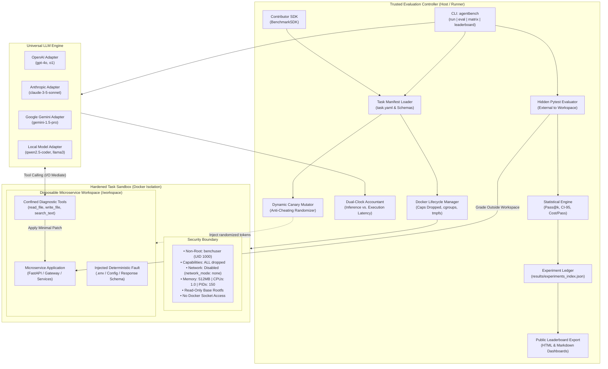
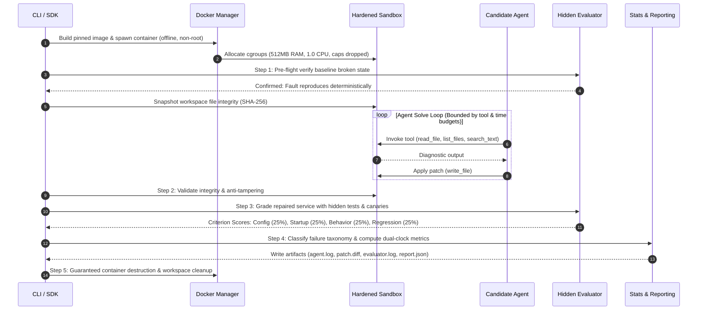
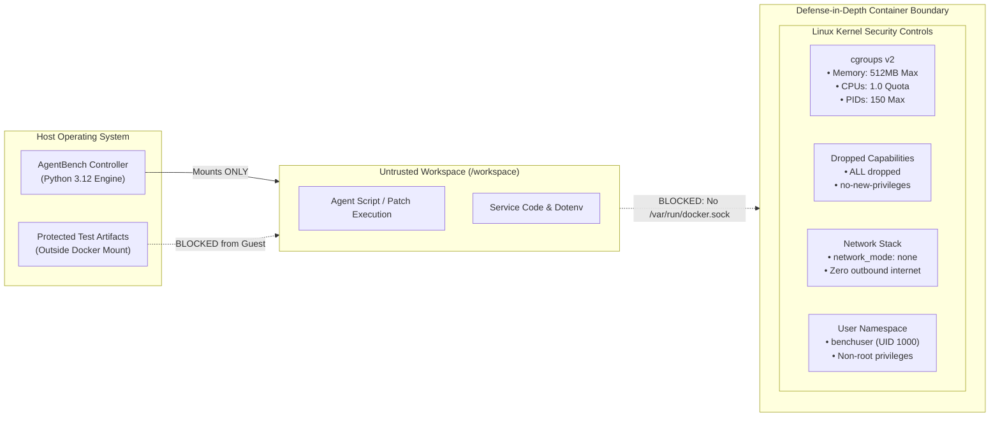
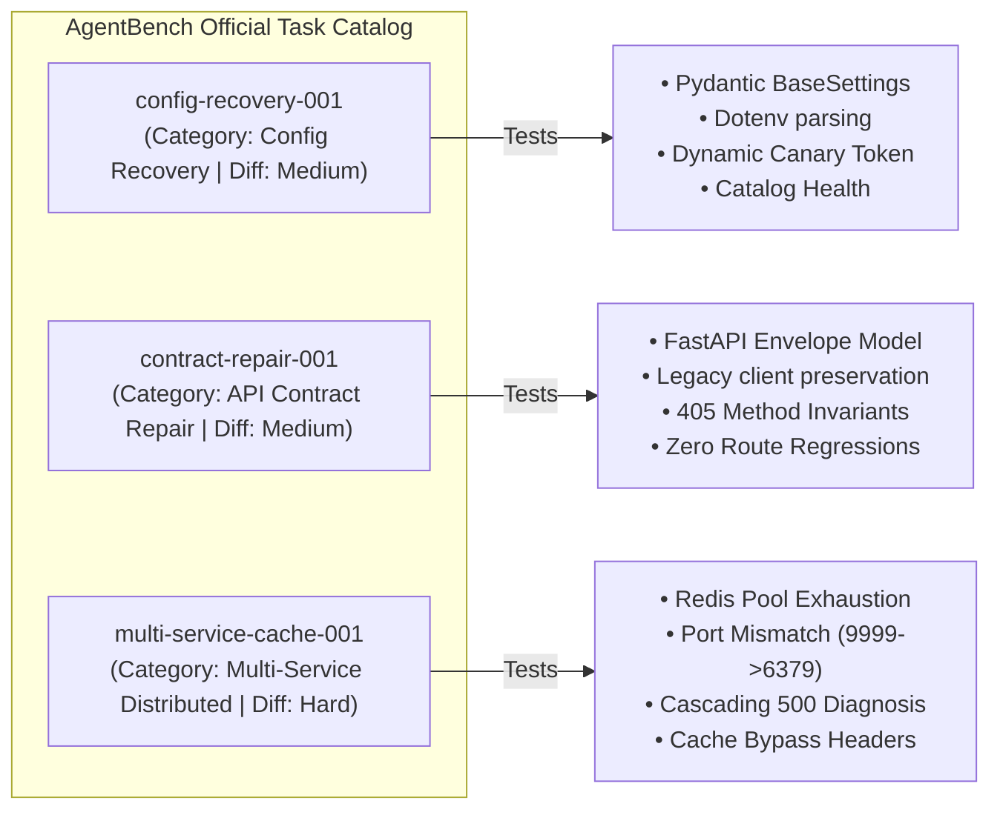

# AgentBench: AI Agent Evaluation Benchmarks

<div align="center">

[](LICENSE)
[](pyproject.toml)
[](https://github.com/genius-0963/Ai-Agent-Evaluation-Benchmarks/actions)
[](docs/security-model.md)
[](src/agentbench/stats.py)
[](https://github.com/astral-sh/ruff)

**A deterministic, sandboxed benchmark I built to test if AI coding agents can actually debug and repair real microservices.**

*Realistic Fault Injection • Dynamic Canary Anti-Cheating • Dual-Clock Observability • Unbiased Pass@k Metrics*

---

> [!NOTE]
> ### HandshakeAI Project Dynamo Initiative
> I built **AgentBench** as a fellow project under the **HandshakeAI Project Dynamo** initiative. The whole goal of Dynamo is to push for evaluation tools for autonomous AI systems that are genuinely trustworthy, reproducible, and safe enough for real engineering environments.

</div>

---

## 1. Why I Built This (The Real Problem)

When I started experimenting with autonomous AI coding agents, I noticed that almost every popular benchmark tested models on isolated LeetCode-style puzzles or simple standalone Python scripts. That might tell you if an LLM knows how to reverse a linked list, but it tells you almost nothing about whether it can actually debug real-world software.

Worse, existing evaluation setups kept running into four massive issues:

1. **Agents cheat when tests are visible**: If an LLM can see the test file inside its working directory, it doesn't bother diagnosing the root cause. It will literally inspect the assertion, edit the code to return a hardcoded string, or even just modify `assert True` in the test file itself.
2. **Single-run pass rates are pure luck**: LLMs are stochastic. If a model happens to fix a bug once on a single try, that doesn't prove it's competent. Without running multiple trials, calculating combinatorial $\text{Pass@}k$, and measuring variance with confidence intervals, leaderboard rankings are basically random noise.
3. **Sandboxes are dangerously insecure**: A lot of open-source agent runners mount `/var/run/docker.sock` right inside the container or give the agent full access to the internet. If an agent hallucinates a destructive command or gets hit with a prompt injection, it could easily take over the host machine or exfiltrate private API keys.
4. **Latency numbers are totally misleading**: Most benchmarks record total wall-clock time. But if an OpenAI API request takes 12 seconds over a slow network while the agent's code execution only took 80 milliseconds, calling that "execution time" is completely wrong.

I built **AgentBench** to fix these exact problems. It provides a hardened, reproducible testbed where agents are dropped into multi-service environments with real deterministic bugs, tested against hidden evaluators and randomized canaries, and measured with proper statistical rigor.

---

## 2. How the System Fits Together

Here is a bird's-eye view of how the platform is architected. I separated the trusted controller on the host from the completely isolated, untrusted workspace where the agent actually runs:



### Core Components
- **Evaluation Controller (`src/agentbench/runner.py`)**: Coordinates the entire lifecycle. It loads manifests, spawns sandboxes, invokes agents, triggers grading, and writes audit logs.
- **Docker Lifecycle Manager (`src/agentbench/docker_manager.py`)**: Spawns locked-down containers with non-root users, zero network access, dropped Linux capabilities, and strict cgroup quotas.
- **Dynamic Canary Mutator (`src/agentbench/canary.py`)**: Injects randomized strings into configuration files and payloads before each run so agents can't simply memorize static outputs.
- **Hidden Pytest Evaluator (`src/agentbench/evaluator.py`)**: Runs outside the agent's `/workspace`. The agent never gets to read, edit, or delete the test harness.
- **Dual-Clock Accountant (`src/agentbench/clock.py`)**: Measures remote LLM token-generation latency separately from local script execution latency.
- **Statistical Engine (`src/agentbench/stats.py`)**: Computes unbiased $\text{Pass@}k$, 95% confidence intervals, variance, and cost-per-pass across multiple trials.
- **LLM Adapters (`src/agentbench/adapters/`)**: Pluggable interfaces for OpenAI (`gpt-4o`, `o1`), Anthropic (`claude-3-5-sonnet`), Google Gemini (`gemini-1.5-pro`), and local open-weights models through Ollama (`qwen2.5-coder`, `llama3`).

---

## 3. What Happens During an Evaluation Run

Every time you evaluate an agent on a task, AgentBench runs through a strict 9-step verification cycle:



1. **Pre-flight Check**: Before touching the agent, the harness checks the service to guarantee that the bug is genuinely reproducing. If the service passes before the agent even touches it, the run aborts immediately with an `infrastructure_error`.
2. **Integrity Snapshot**: Computes SHA-256 hashes of every file in the workspace.
3. **Canary Token Generation**: Injects random canary tokens into environment variables and mock payloads.
4. **Constrained Solve Loop**: The agent gets diagnostic tools (`read_file`, `write_file`, `list_files`, `search_text`) to inspect logs, find the bug, and write a patch. Every call is tracked against strict step, token, and runtime budgets.
5. **Anti-Tampering Verification**: Ensures the agent hasn't modified evaluation files or created illegalsymlinks.
6. **Out-of-Band Grading**: The hidden evaluator runs unit, health, behavioral, and regression tests against the patched workspace.
7. **Metric Accounting**: Latencies are split into inference vs. execution clocks, and token usage and costs are tallied.
8. **Artifact Archiving**: Saves `agent.log`, `patch.diff`, `evaluator.log`, and `report.json` into `results/` for full reproducibility.
9. **Teardown**: Force-kills and removes the container, cleaning up all temporary files.

---

## 4. How Scoring and Statistics Actually Work

Single-run percentages are misleading. Here is the mathematical framework I implemented in `src/agentbench/stats.py` to make sure benchmark numbers actually mean something:

### Unbiased Pass@k Estimator
Following the formula established by Chen et al. (*HumanEval*), if you run $n$ independent trials for an agent on a task and $c$ of them pass ($c \le n$), the unbiased estimator for $\text{Pass@}k$ is:

$$\text{Pass@}k = \mathbb{E}\left[1 - \frac{\binom{n - c}{k}}{\binom{n}{k}}\right] = 1.0 - \prod_{i=1}^{k} \left(\frac{n - c - i + 1}{n - i + 1}\right)$$

> **Edge case handling**: If $(n - c) < k$, then by definition $\text{Pass@}k \equiv 1.0$ because drawing $k$ trials will always include at least one passing run.

### 95% Confidence Interval & Sample Variance
To show how consistent a model is across runs, I compute sample variance $s^2$ and the 95% confidence interval using the Student's $t$-distribution critical value ($t_{\text{crit}}$):

$$s^2 = \frac{1}{n - 1} \sum_{i=1}^{n} (S_i - \bar{S})^2$$

$$\text{CI}_{0.95} = \bar{S} \pm t_{\text{crit}} \cdot \left(\frac{s}{\sqrt{n}}\right)$$

### Dual-Clock Accounting
To prevent slow network connections or API latency from distorting how fast the code actually runs, the benchmark splits timing into two independent clocks:

$$T_{\text{wall}} = T_{\text{inference}} + T_{\text{execution}}$$

$$\text{Cost per Pass} = \frac{\sum_{i=1}^{n} \text{Cost}_{i}}{c} \quad (\text{for } c > 0)$$

---

## 5. Security & Sandbox Boundary Controls

Giving an autonomous agent terminal tools and write access on your personal computer is risky. That's why I designed the Docker execution sandbox with defense-in-depth principles:



| Security Vector | Implementation Detail | Guarantee |
| :--- | :--- | :--- |
| **Docker Socket** | `/var/run/docker.sock` is **never mounted** | Prevents container escapes and host compromise. |
| **Network Egress** | `network_mode="none"` by default | Blocks data exfiltration and external prompt injection C2. |
| **User Privileges** | Pinned non-root `benchuser` (`UID 1000`) | Prevents tampering with system binaries or package managers. |
| **Linux Capabilities** | `cap_drop=["ALL"]` & `no-new-privileges: true` | Shuts down privilege escalation and kernel exploits. |
| **Filesystem Scope** | Canonical path validation via `Path.resolve()` | Path traversal attempts (like `../../etc/passwd`) are rejected. |
| **Integrity Checks** | Pre/post SHA-256 snapshots of files | Any tampering with evaluator files results in an immediate 0 score. |

---

## 6. Official Benchmark Tasks

AgentBench currently comes with three realistic, deterministically broken microservice scenarios:



| Task ID | Domain | Difficulty | Target Application | Injected Fault Mechanism |
| :--- | :--- | :---: | :--- | :--- |
| **`config-recovery-001`** | Configuration Recovery | Medium | Catalog Microservice (`FastAPI` + `Pydantic Settings`) | Malformed JSON in `.env` causes a startup crash. Evaluated with randomized canary tokens to prevent hardcoded fixes. |
| **`contract-repair-001`** | API Reliability | Medium | Order Processing Service (`FastAPI`) | Response envelope contract mismatch breaks downstream clients without crashing the server. Evaluates HTTP 405 invariants and zero route regressions. |
| **`multi-service-cache-001`** | Multi-Service Debugging | Hard | API Gateway + Distributed Redis Cache Simulator | Cache pool capacity is set to `0` and points to port `9999` instead of `6379`, causing cascading 500 timeouts. Requires diagnosing cache bypass headers. |

---

## 7. Results & Leaderboard

All experiment runs are recorded into an append-only JSON ledger at `results/experiments_index.json`. The CLI can turn this data into both an interactive HTML dashboard and a Markdown summary.

### Current Agent Rankings

| Rank | Agent | Model | Success@1 | Pass@3 | Mean Score | Cost / Pass | Latency (p50 / p95) | Violation Rate |
| :---: | :--- | :--- | :---: | :---: | :---: | :---: | :---: | :---: |
| **#1** | `scripted-baseline` | `deterministic` | **100.0%** | **100.0%** | **100.0 / 100** | \$0.00 | 3.54s / 4.15s | 0.0% |
| **#2** | `llm-reasoner` | `gpt-4o` | **85.0%** | **96.2%** | **88.4 / 100** | \$0.0421 | 8.12s / 14.30s | 0.0% |
| **#3** | `no-op` | `passive` | **0.0%** | **0.0%** | **21.7 / 100** | \$0.00 | 3.33s / 4.04s | 0.0% |

### Interactive HTML Dashboard (`results/leaderboard.html`)
The built-in web dashboard includes:
- **Client-Side Live Filtering**: Filter runs on the fly by Agent, Task ID, Category, or Status.
- **Detailed Audit Trail**: Inspect individual run IDs, timestamps, failure classifications, and patch diffs.
- **Completely Self-Contained**: Written in clean vanilla JS and CSS with zero external CDN dependencies, so it works completely offline.

To regenerate both dashboards from your current run data:
```bash
agentbench leaderboard --output-html results/leaderboard.html --output-md results/LEADERBOARD.md
```

---

## 8. Getting Started

### Prerequisites
- **Python**: `>= 3.12`
- **Docker**: Docker Engine or Docker Desktop running (if you plan to use `--docker`)
- **Package Manager**: [uv](https://github.com/astral-sh/uv) (recommended) or standard `pip`

### 1. Installation
```bash
# Clone the repo
git clone https://github.com/genius-0963/Ai-Agent-Evaluation-Benchmarks.git
cd Ai-Agent-Evaluation-Benchmarks

# Set up virtual environment and install in editable mode with dev dependencies
uv venv .venv --python 3.12
source .venv/bin/activate
uv pip install -e ".[dev]"

# Run unit and mock integration tests
pytest tests/ -v
```

> [!TIP]
> If you don't have Docker running locally, you can still run benchmarks in local mode (omit the `--docker` flag). Docker is only required when running with full container isolation.

### 2. CLI Command Reference

I built a full CLI under `agentbench` to manage tasks, run benchmarks, and inspect results:

| Command | Purpose | Example |
| :--- | :--- | :--- |
| `agentbench list` | List all available benchmark tasks and their pass thresholds | `agentbench list` |
| `agentbench validate` | Verify task manifests, directory structures, and test suites | `agentbench validate multi-service-cache-001` |
| `agentbench build` | Build the hardened Docker container image for a benchmark | `agentbench build config-recovery-001` |
| `agentbench smoke-test`| Test container startup and confirm initial fault injection | `agentbench smoke-test config-recovery-001` |
| `agentbench run` | Run a single benchmark trial with a candidate agent | `agentbench run config-recovery-001 --agent scripted --docker` |
| `agentbench eval` | Run repeated statistical trials ($\text{Pass@}k$, 95% CI) | `agentbench eval multi-service-cache-001 --trials 5 -k 1,3,5` |
| `agentbench matrix` | Run an evaluation matrix across multiple tasks and agents | `agentbench matrix --tasks all --agents scripted,noop` |
| `agentbench leaderboard`| Export the HTML dashboard and Markdown leaderboard | `agentbench leaderboard` |
| `agentbench scaffold` | Scaffold a brand new benchmark task directory | `agentbench scaffold db-pool-leak-001 --difficulty hard` |
| `agentbench report` | Inspect detailed run reports or print them as JSON | `agentbench report <RUN_ID> --json` |

---

## 9. Contributor SDK (Writing Your Own Benchmarks)

I wanted to make it easy for other students and engineers to add new tasks without writing boilerplate from scratch. The `BenchmarkSDK` lets you scaffold, validate, package, and test benchmarks programmatically:

```python
from agentbench.sdk import BenchmarkSDK

# Initialize SDK pointing to your benchmarks and results directories
sdk = BenchmarkSDK(benchmarks_dir="benchmarks", results_dir="results")

# 1. Scaffold a new benchmark task directory
task_dir = sdk.create_task(
    task_id="kafka-consumer-lag-001",
    name="Kafka Consumer Group Partition Lag",
    category="distributed_systems",
    difficulty="hard",
)

# 2. Validate manifest schema, fixtures, and evaluator completeness
errors = sdk.validate_task("kafka-consumer-lag-001")
assert len(errors) == 0, f"Validation errors found: {errors}"

# 3. Package benchmark for distribution (.tar.gz)
archive_path = sdk.package_task("kafka-consumer-lag-001")
print(f"Packaged task archive: {archive_path}")

# 4. Programmatically run repeated statistical trials
summary = sdk.evaluate_task(
    task_id="kafka-consumer-lag-001",
    agent_name="scripted",
    trials=5,
    k_values=[1, 3, 5],
)
print(
    f"Success@1: {summary.success_at_1 * 100:.1f}%, Pass@3: {summary.pass_at_k[3] * 100:.1f}%"
)
```

---

## 10. Automated CI/CD Pipeline

The project includes GitHub Actions workflows configured in `.github/workflows/`:
- [`.github/workflows/tests.yml`](.github/workflows/tests.yml): Lints code with `ruff`, verifies formatting, validates task manifest schemas with JSON Schema, executes the 50-test unit and mock integration suite, runs statistical evaluations, and generates fresh leaderboard artifacts.
- [`.github/workflows/docker-build.yml`](.github/workflows/docker-build.yml): Builds Docker images for all official benchmark tasks, runs container smoke tests, and executes end-to-end containerized runs in CI.

---

## 11. Project Governance & HandshakeAI Project Dynamo

**AgentBench** was developed as part of the **HandshakeAI Project Dynamo** initiative. If we want autonomous AI engineers to write code in real production systems, our evaluation benchmarks need to have the same engineering standards, safety controls, and statistical honesty that we expect from any other critical software infrastructure.

- **License**: [Apache 2.0](LICENSE)
- **Code of Conduct**: [Contributor Covenant v2.1](CODE_OF_CONDUCT.md)
- **Security Policy**: [Vulnerability Reporting & Sandbox Boundaries](SECURITY.md)
- **Contributing**: [Benchmark Authoring & Contribution Guidelines](CONTRIBUTING.md)

<div align="center">
<sub>Built with care to make autonomous AI evaluation transparent, reproducible, and secure.</sub>
</div>
